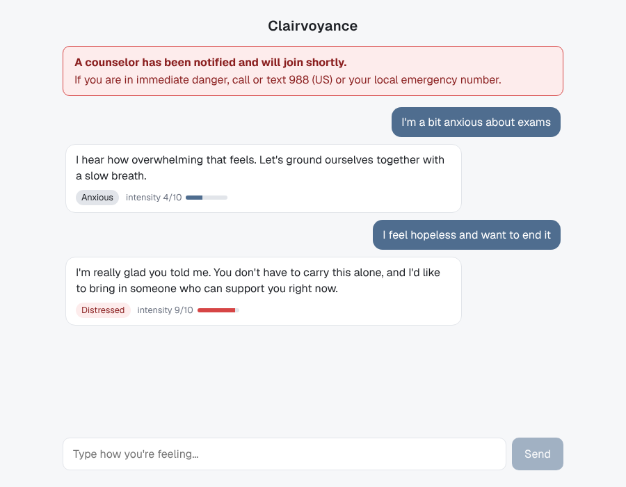
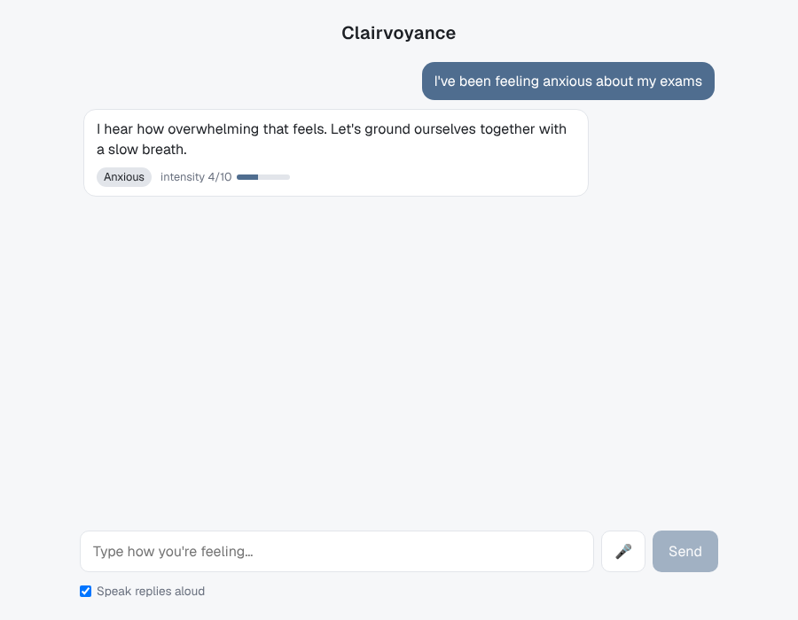
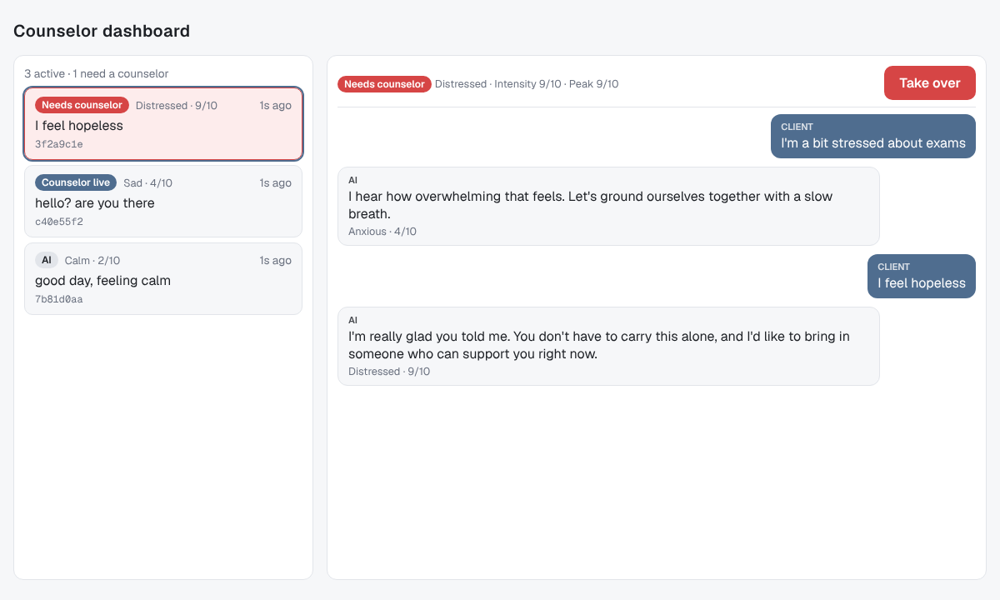

# Clairvoyance

AI-assisted mental-health intake and triage. A Live2D avatar handles baseline
intake; a student counselor takes over high-priority sessions live.

## Layout

| Path | What |
|---|---|
| `apps/api` | FastAPI backend (chat, triage, session tracking) |
| `apps/web` | Next.js client: chat page (`/`) and counselor dashboard (`/dashboard`) ([README](apps/web/README.md)) |
| `apps/mobile` | Expo client (not started) |
| `packages` | Shared TS code (not started) |

## Backend quickstart

```bash
cd apps/api
python -m venv .venv && source .venv/bin/activate
pip install -r requirements-dev.txt
pytest
uvicorn src.main:app --reload   # docs at http://localhost:8000/docs
```

Set `CORS_ORIGINS` (comma-separated) to change which browser origins may call
the API; it defaults to `http://localhost:3000` for the web app.

Or with Docker: `docker build -t clairvoyance-api apps/api && docker run -p 8000:8000 clairvoyance-api`.

```bash
curl -X POST localhost:8000/api/v1/chat/message \
  -H 'content-type: application/json' -d '{"message": "I feel hopeless"}'
# {"text_response":"...","sentiment":"distressed","intensity":9,
#  "animation_trigger":"concerned_lean_in","human_takeover_flag":true}
```

## Web quickstart

See [apps/web/README.md](apps/web/README.md) (PowerShell commands included).



## Voice + real Qwen, locally

Mic → faster-whisper → Qwen 2.5 (Ollama) → triage → reply, all on your machine:
see [docs/local-voice-setup.md](docs/local-voice-setup.md). Short version:

```powershell
winget install --id Ollama.Ollama
.\scripts\start-api.ps1          # checks + starts the API with Qwen 2.5 and Whisper
.\scripts\smoke-test.ps1         # second terminal: speech -> Whisper -> Qwen check
cd apps/web; npm install; npm run dev
```

Tests, CI and the GitHub Pages demo keep using the stubs (`LLM_PROVIDER=stub`,
`STT_PROVIDER=stub`, the defaults).



## How triage works

1. `services/qwen_service.py` defines an `LLMClient` interface with two
   implementations: a deterministic keyword stub (`LLM_PROVIDER=stub`, the
   default) and `OpenAICompatQwenClient` (`LLM_PROVIDER=openai`), which talks to
   Ollama or any hosted OpenAI-compatible Qwen endpoint.
2. `utils/triage_rules.py` validates the model output (clamps intensity to 1-10,
   maps unknown sentiments to `neutral`) and decides `human_takeover_flag`:
   true when intensity >= 8 **or** the message contains crisis language. The
   model never sets the flag itself.

> The stub and keyword list are placeholders, not clinically validated.

## Counselor dashboard



The chat endpoint records every session (keyed by the `session_id` the client
sends) with its message history, latest sentiment and intensity, peak
intensity, and status:

| Status | Meaning |
|---|---|
| `ai` | AI is replying, nothing flagged |
| `flagged` | Triage asked for a human; AI still replying. Sticky once set. |
| `counselor` | A counselor took over. The model is not called; the client gets a holding line and `ai_paused: true`. Crisis language still flags the session. |

| Endpoint | What |
|---|---|
| `GET /api/v1/sessions` | Summaries, flagged first, then counselor, then AI; newest activity first in each |
| `GET /api/v1/sessions/{id}` | Summary plus full transcript |
| `POST /api/v1/sessions/{id}/takeover` | Pause the AI (idempotent) |
| `POST /api/v1/sessions/{id}/release` | Hand back to the AI (idempotent) |

Known gaps:

- **No auth.** Anyone who can reach the API can read transcripts and take over
  sessions. Needs counselor accounts before any real client data.
- **In-memory store.** Sessions vanish on restart and aren't shared across
  workers. PostgreSQL (history) and Redis (live state) replace
  `services/session_store.py`.
- **No counselor replies yet.** Takeover pauses the AI, but the counselor can't
  message the client until a WebSocket channel exists. The dashboard polls
  every 3 seconds for the same reason.
