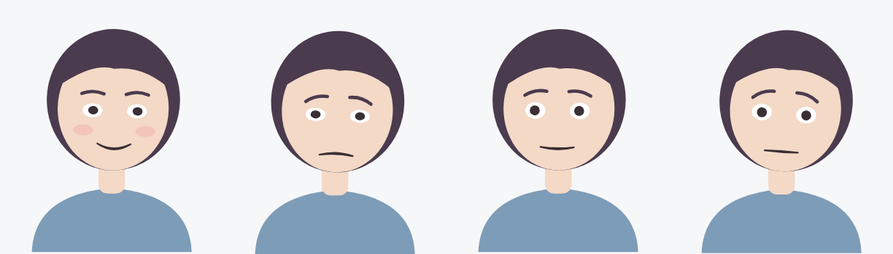

# web

Next.js client for Clairvoyance. Today it is a single chat page that calls
`POST /api/v1/chat/message` and shows the reply, the sentiment, the intensity,
a takeover banner when the API sets `human_takeover_flag`, and an avatar that
reacts to each reply (see [Avatar](#avatar)). Messages can be typed or
spoken (mic button); see [local voice setup](../../docs/local-voice-setup.md).

`/dashboard` is the counselor view: sessions with flagged ones first, the
transcript of the selected session, and a Take over / Hand back button. It polls
the API every 3 seconds. No login yet (see the root README's known gaps).


## Run it locally (Windows PowerShell)

Start the API in one terminal:

```powershell
cd apps/api
python -m venv .venv
.\.venv\Scripts\Activate.ps1
pip install -r requirements-dev.txt
uvicorn src.main:app --reload
```

Start the web app in a second terminal (Node 20.9+):

```powershell
cd apps/web
npm install
npm run dev
```

Open http://localhost:3000 for the chat and http://localhost:3000/dashboard for the counselor view.

The API URL defaults to `http://localhost:8000`. To point elsewhere, copy
`.env.example` to `.env.local` and change `NEXT_PUBLIC_API_URL`. The API only
accepts browser calls from origins in its `CORS_ORIGINS` env var
(comma-separated, default `http://localhost:3000`).

## Checks

```powershell
npm run lint
npm run typecheck
npm test
npm run build
```

## Layout

| Path | What |
|---|---|
| `src/app/page.tsx` | Page shell |
| `src/components/Chat.tsx` | Chat UI and state (client component) |
| `src/components/Chat.test.tsx` | Vitest + Testing Library tests, `fetch` mocked |
| `src/components/MicButton.tsx` | Tap-to-record mic; uploads audio to `/api/v1/speech/transcribe` |
| `src/components/MicButton.test.tsx` | Voice flow tests, `MediaRecorder` and `fetch` mocked |
| `src/lib/api.ts` | Typed client; types mirror `apps/api/src/schemas.py` |
| `src/lib/speech.ts` | "Speak replies aloud" via browser speech synthesis |
| `src/app/dashboard/page.tsx` | Counselor dashboard route |
| `src/components/Dashboard.tsx` | Session list, transcript, takeover toggle (client component) |
| `src/lib/sessions.ts` | Typed client for `/api/v1/sessions` |

## Avatar

The chat page shows an avatar that reacts to each reply: `sentiment` and
`intensity` set its expression, `animation_trigger` plays a gesture, and it
lip-flaps while "speaking" (synced to real speech when "Speak replies aloud" is on). Open http://localhost:3000/avatar-lab to try every
sentiment, intensity, trigger and parameter by hand, or send a message through
the API and watch the avatar react.



How it fits together:

| Path | What |
|---|---|
| `src/lib/avatar/params.ts` | Parameter set, using Live2D Cubism's standard IDs (`ParamAngleX`, `ParamMouthForm`, ...) and ranges |
| `src/lib/avatar/expressions.ts` | Sentiment + intensity → target expression |
| `src/lib/avatar/motions.ts` | One gesture per `animation_trigger`; unknown triggers fall back to idle |
| `src/lib/avatar/driver.ts` | `AvatarDriver`: per-frame easing, blinking, breathing, motions, lip flap, overrides |
| `src/components/avatar/renderer.ts` | `AvatarRenderer` interface: `render(params)` |
| `src/components/avatar/SvgFace.tsx` | Placeholder SVG renderer |
| `src/components/avatar/Avatar.tsx` | Runs the animation loop; props: `state: AvatarState` |
| `src/components/avatar/AvatarLab.tsx` | The `/avatar-lab` debug page |

Two ways to drive it:

- **AI autopilot:** set `sentiment`, `intensity`, `motion` (+ bump `motionKey`
  to replay) and `speaking` on `AvatarState`.
- **Counselor takeover (later):** a face tracker such as MediaPipe Face Mesh
  writes `paramOverrides` every frame (e.g. `ParamAngleX` from head yaw,
  `ParamEyeLOpen` from eye aspect ratio). Overrides win over everything else.
  The lab's "Lock parameters" sliders simulate this.

### Swapping in Live2D

The placeholder exists because of licensing, not effort. Checked 2026-10-23:

- The Cubism SDK is free to publish with for individuals and small businesses
  (under ¥10M annual revenue), **except "Expandable Applications"**, which need
  Live2D's review and a paid contract. Live2D lists face-tracking software in
  that category, so counselor face-driven takeover should be cleared with Live2D
  before release.
- Cubism Core (`live2dcubismcore.min.js`) is proprietary; it cannot be committed
  to a public repo, so each developer and the CI build would download it.
- Sample models (Hiyori, Haru, ...) can't be redistributed as raw files or
  modified, so they can't live in this public repo either.

To switch: write a `Live2DRenderer` implementing `AvatarRenderer` that calls
`model.setParameterValueById(id, value)` for each param, and render it in
`Avatar.tsx` instead of `SvgFace`. Nothing else changes.
